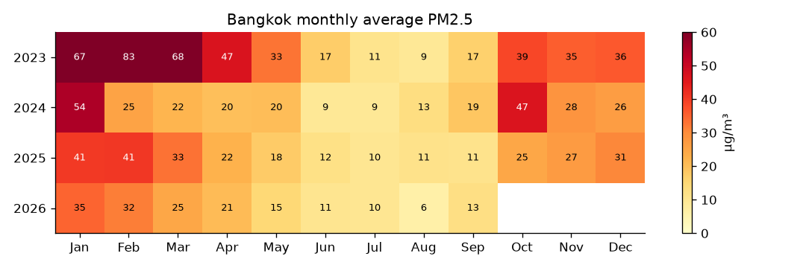
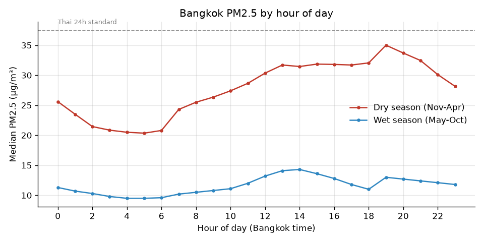
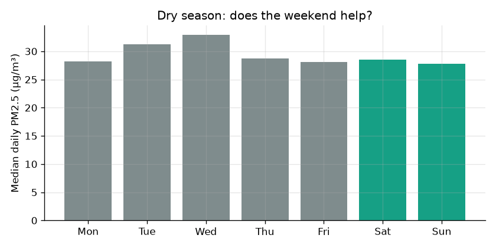
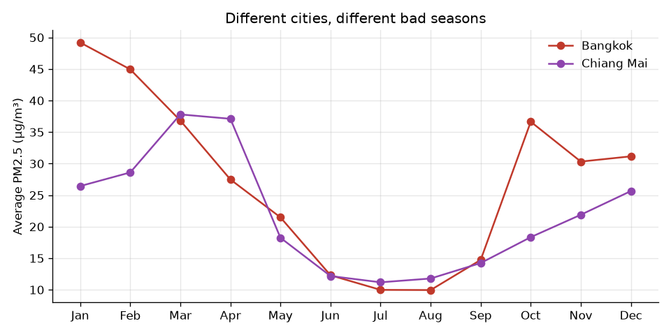

# Bangkok PM2.5 — when is it actually bad?

Every January my feed fills up with "the dust is back again" posts, and I wanted to answer a few simple questions with data instead of vibes:

1. Which months are really the problem?
2. Is there a better time of day to go outside / go for a run?
3. Does the weekend help (less traffic = less dust)?
4. Is it getting better or worse?

Data: hourly PM2.5 for Bangkok and Chiang Mai, Jan 2023 – Sep 2026, from the [Open-Meteo Air Quality API](https://open-meteo.com/en/docs/air-quality-api).

## What I found

**January is the worst month, and October is the start of the bad season, not November.**
Bangkok's average in January is ~49 µg/m³. I expected the bad season to start in November, but October 2023 and October 2024 were both high (39 and 47), worse than the November that followed.



**Early morning is the cleanest time. Evenings are the worst.**
In the dry season the median drops to ~20 µg/m³ around 4–6 AM and peaks at ~35 around 7 PM. So if you run after work in January, you're running at the worst hour of the day. 6 AM vs 6 PM is roughly 21 vs 32.



**The weekend does not really help.**
I expected Saturday/Sunday to be clearly lower because of less traffic. Sunday is the lowest but only by a little (27.8 vs ~28–33 on weekdays). The weather (wind, inversion layer) seems to matter much more than one or two days of less traffic.



**It has been getting better.**
Days above the Thai 24h standard (37.5 µg/m³) in each dry season (Nov–Apr):

| Dry season | Days over 37.5 | Worst day |
|---|---|---|
| 2022/23 (Jan–Apr only) | 80 of 120 | 276 |
| 2023/24 | 47 | 120 |
| 2024/25 | 47 | 93 |
| 2025/26 | 36 | 61 |

But measured against the WHO guideline (15 µg/m³) almost every dry-season day is still over: 172 of 181 days last season. "Better" is not the same as "fine".

**Bangkok and Chiang Mai have different problem months.**
Bangkok peaks in January (traffic + still air). Chiang Mai peaks in March–April (burning season).



## Limitations (please read)

- This is **model data** (CAMS reanalysis), not readings from ground sensors like Air4Thai. It is good for patterns (which month, which hour) but it smooths out the peaks.
- That is very visible for Chiang Mai: the model's worst March is ~38 µg/m³ on average, while real sensors there regularly show 100+ during the burning season. So don't use the Chiang Mai numbers as absolute values.
- One point per city (city center). Bangkok is big — Bang Na and Lat Krabang are not the same as Silom.
- 2026 only goes to September.

Next step if I continue: compare against Air4Thai station data to see how far off the model is.

## Run it yourself

```bash
pip install -r requirements.txt
python fetch_data.py     # downloads into data/
python analysis.py       # prints the numbers + saves charts/
```

The data CSVs are included in the repo so `analysis.py` works without downloading.
